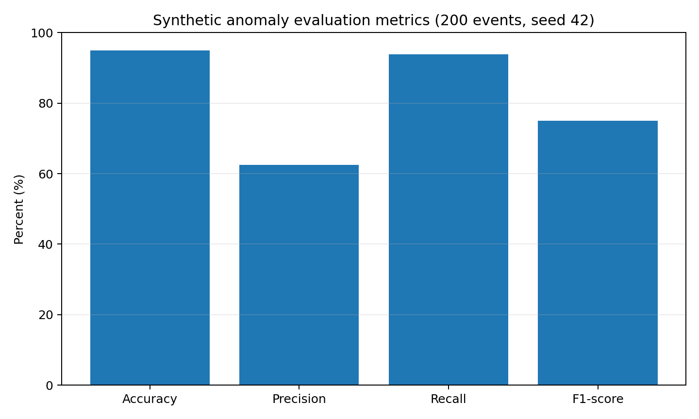
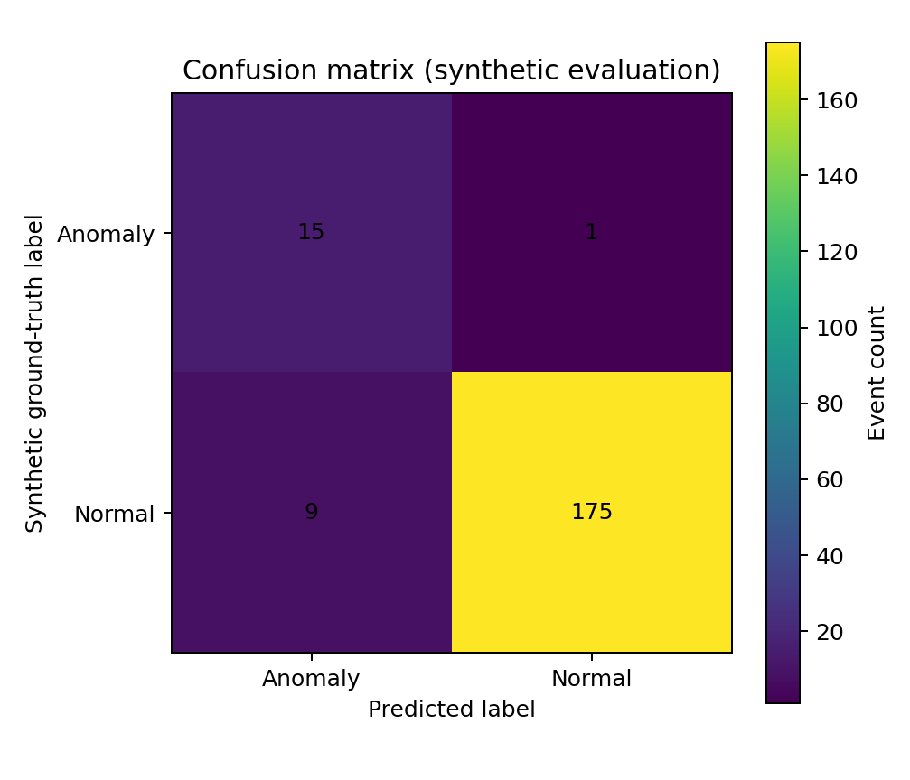

# AI Evaluation Report

## 1. Evaluation method in the repository

The script `scripts/evaluate_model.py` calls `ModelEvaluator().evaluate(n_events=200, seed=42)`.

The evaluator:
1. Generates 200 synthetic opening events.
2. Marks approximately 5% as extreme timing anomalies by construction.
3. Generates mild delays (20–60 minutes) that are labeled as non-anomalies.
4. Generates regular events with small timing variation.
5. Extracts the same five features used by the live anomaly detector.
6. Runs `ConsensusDetector.fit_predict()` on the complete generated feature matrix.
7. Compares the predicted anomaly indices with the synthetic labels and calculates Precision, Recall, F1, Accuracy, and confusion counts.

The detector is fitted and scored on the same dataset. There is no held-out test set in this evaluator.

## 2. Reproduced result

The supplied code was executed with 200 events and seed 42. It returned:

| Metric | Value |
|---|---:|
| Events analyzed | 200 |
| True synthetic anomalies | 16 |
| Predicted anomalies | 24 |
| Precision | 0.625 (62.5%) |
| Recall | 0.938 (93.8%) |
| F1-score | 0.750 (75.0%) |
| Accuracy | 0.950 (95.0%) |
| Threshold | 0.8646 |
| True positives (TP) | 15 |
| False positives (FP) | 9 |
| True negatives (TN) | 175 |
| False negatives (FN) | 1 |





## 3. Interpretation

- Recall of 93.8% means the detector found 15 of the 16 anomalies in this particular synthetic run.
- Precision of 62.5% means 9 of the 24 flagged events were false positives against the synthetic labels.
- Accuracy of 95% is influenced by the fact that most generated events are normal (184 out of 200).
- The synthetic generator's assumptions determine what counts as an anomaly. These labels are not independently reviewed clinical ground truth.

## 4. Why there is no training-loss graph

The current anomaly pipeline is not a gradient-trained neural network. It does not run epochs or optimize a loss function. Its `fit()` methods build isolation trees or estimate mean/covariance statistics.

Therefore, a conventional training-loss/validation-loss curve would be misleading and is not available from this source.

Useful graphs for this version are:
- Precision / Recall / F1 / Accuracy from a clearly labeled synthetic evaluation.
- Confusion matrix.
- Anomaly score distribution for a fixed evaluation dataset.
- Real event delay over time once enough labeled device data has been collected.
- False-positive and false-negative counts from reviewed real test sessions.

## 5. Reproducibility

On the Raspberry Pi, from the project directory:

```bash
python3 scripts/evaluate_model.py
```

Expected JSON includes the metrics, confusion matrix, seed, method, threshold, and synthetic-data disclaimer.

The result can vary if code, NumPy behavior, or random-seed handling changes. Record the project Git commit, Python version, NumPy version, seed, event count, and timestamp for every experiment.

## 6. Required next evaluation phase

Before making real-world performance claims:
1. Collect consented, de-identified device event logs.
2. Define the target precisely: late opening, missed scheduled opening, wrong compartment, or another event.
3. Create independent labels reviewed by a human.
4. Split data by person or by time into train/validation/test sets to reduce leakage.
5. Tune thresholds on validation data only.
6. Report test metrics with sample counts and confidence intervals.
7. Measure false alerts per patient-day and missed events, not only accuracy.
8. Repeat across different schedules and usage patterns.

No patient-level or clinical accuracy claim should be made from the current synthetic evaluation.
