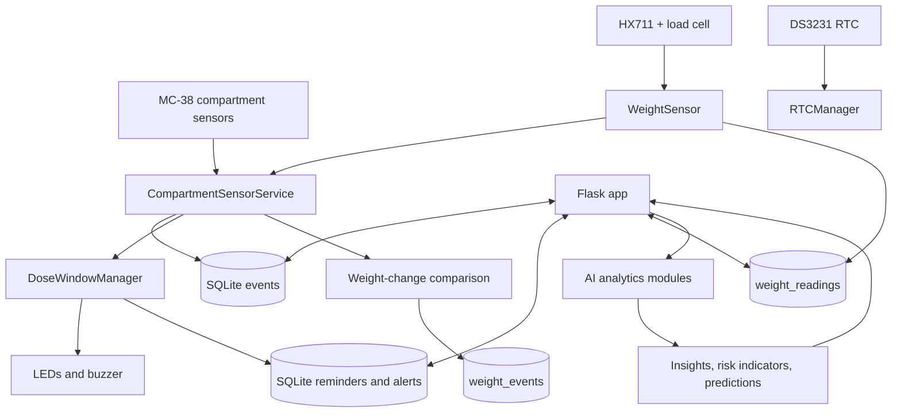

# System Architecture

## 1. System purpose

The codebase implements a medication-adherence monitoring prototype. It records compartment openings and closings, generates reminders and alerts, collects selected weight readings, exposes the data through a Flask API, and derives behavioral summaries.

It does **not** directly confirm ingestion. A compartment opening is only evidence that a lid changed state.

## 2. High-level architecture

## 3. Startup sequence

`main.py` performs these steps:

1. Initializes the SQLite schema.
2. Creates the DS3231 RTC manager and attempts to sync it from system UTC time when the RTC is available.
3. Initializes the HX711 weight sensor. Failure is treated as a warning and the app continues without the weight sensor.
4. Starts the four-compartment sensor service.
5. Starts the dose-window manager.
6. Creates the Flask app, injects hardware services into app configuration, and serves on port 5000.

On shutdown, the `finally` block stops the dose manager and sensor service and closes alert/weight resources.

## 4. Main software modules

| Module | Responsibility |
|---|---|
| `main.py` | Hardware/database/web startup orchestration |
| `app/__init__.py` | Flask application factory and page routes |
| `app/routes/api.py` | REST-style JSON endpoints |
| `app/services/reminder_service.py` | Separate periodic schedule checker |
| `database/database.py` | SQLite connection factory and schema initialization |
| `hardware/compartment_sensors.py` | Detects open/close transitions and records events |
| `hardware/dose_window_manager.py` | Scheduled dose-window state machine, LEDs, wrong-action alarms |
| `hardware/weight_sensor.py` | HX711 raw reading, median filtering, gram conversion |
| `hardware/rtc_manager.py` | DS3231 read/write/sync |
| `hardware/alert_controller.py` | Buzzer control |
| `ai/ml_core.py` | Feature extraction and anomaly detection |
| `ai/cognitive_engine.py` | Pattern classification, risk score, explanation |
| `ai/prediction_engine.py` | Next-dose heuristic |
| `ai/model_evaluation.py` | Synthetic labeled evaluation |
| `ai/timeline_builder.py` | Combines events, weight events, alerts, and reminders |

## 5. Data flow

1. A magnetic sensor changes state.
2. The sensor service writes an `opened` or `closed` row to `events`.
3. Registered callbacks notify the dose-window manager.
4. The manager checks whether the opening matches the active scheduled compartment and state.
5. The manager updates LEDs, emits buzzer patterns, and updates reminder/alert records.
6. For compartment 4, the sensor service reads weight before/after the open-close cycle. A change of at least 5 grams is logged as a possible addition/removal.
7. The AI modules read event/schedule/alert history and return analytics to API endpoints.
8. The web frontend requests API data and displays status, reports, and insights.

## 6. Database entities

The main schema defines these tables:

- `patients`
- `compartments`
- `medications`
- `schedules`
- `events`
- `weight_readings`
- `weight_events`
- `reminders`
- `alerts`
- `ai_insights`
- `device_status`
- `system_config`

`schema_extensions.sql` adds `patient_medical_profiles`, `clinical_notes`, and `prediction_history`. Important: `database/database.py:init_database()` executes only `schema.sql`; it does not automatically execute `schema_extensions.sql`. Apply the extension SQL as a separate migration after the base database exists, and back up the database first. The medical-profile, clinical-notes, and prediction-history endpoints/features can fail if those tables are absent.

## 7. API map

The current API routes include:

- System: `/api/health`, `/api/system/status`, `/api/db/info`
- Hardware/state: `/api/compartments/state`, `/api/rtc/time`, `/api/weight/current`, `/api/weight/events`, `/api/dose/status`
- Event/alert: `/api/events/recent`, `/api/alerts`, `/api/alerts/<id>/acknowledge`, `/api/alerts/acknowledge-all`
- Medication/patient: `/api/medications`, `/api/patient`, `/api/patient/full`, `/api/patient/medical-profile`, `/api/patient/notes`
- AI: `/api/ai/insights`, `/api/ai/insights/detailed`, `/api/ai/evaluation`, `/api/ai/predictions/next-dose`, `/api/ai/predictions/history`
- Reporting: `/api/timeline`, `/api/report/monthly`

## 8. Architecture cautions

- `ReminderService` exists as a separate service, but `main.py` starts `DoseWindowManager`; it does not instantiate `ReminderService`. Avoid describing both as simultaneously active without checking runtime wiring.
- The source currently uses patient ID `1` in several analytics/database paths. Multi-patient isolation is not implemented end-to-end.
- The dashboard/API should be protected before exposing the device beyond a trusted local network. The inspected code does not show authentication or authorization middleware.
